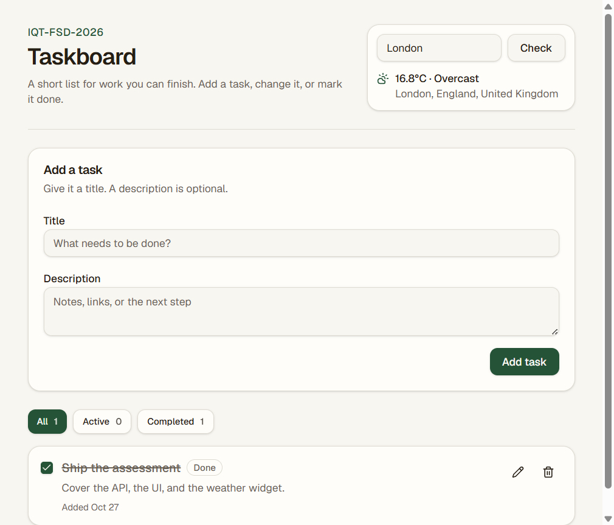

# API integration

## API used

[Open-Meteo](https://open-meteo.com/) — the Geocoding API and the Forecast API. No API key is required.

- Geocoding: `https://geocoding-api.open-meteo.com/v1/search`
- Forecast: `https://api.open-meteo.com/v1/forecast`

## Implementation

The browser never calls Open-Meteo directly. The Taskboard header asks our Express API for `GET /api/weather?city=`.

The handler validates `city` with Zod (required, trimmed, at most 100 characters). The weather service then:

1. Looks up the city and takes the first match (name, region, country, latitude, longitude).
2. Requests the current `temperature_2m` and `weather_code` for that point.
3. Maps the WMO weather code to a short label such as "Partly cloudy" or "Rain".

Unknown cities return `404`. If Open-Meteo times out or responds with an error, the API returns `502`. The widget shows the temperature, condition, and place, and the city can be changed from the form.

The relevant files are:

- `server/src/services/weatherService.ts`
- `server/src/routes/weather.ts`
- `client/src/components/weather/weather-widget.tsx`

## Screenshot

## GitHub commit

Commit these files on their own so the history shows the integration, then paste the commit URL in the application:

- `server/src/services/weatherService.ts`
- `server/src/routes/weather.ts`
- `server/src/validators/task.ts` (weather query schema)
- `client/src/components/weather/weather-widget.tsx`
- `docs/api-integration.md`
- `docs/screenshots/taskboard.png`
